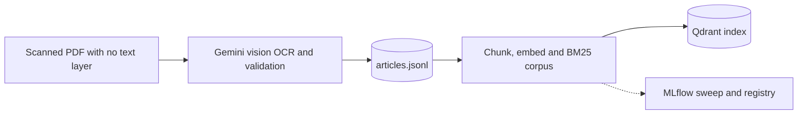
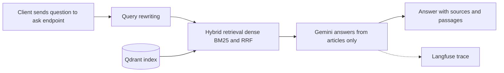
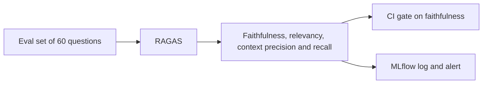
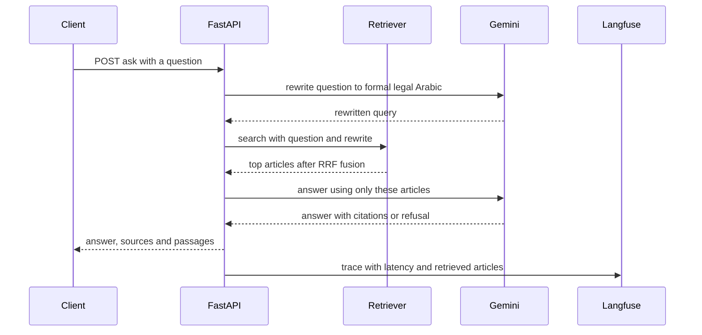
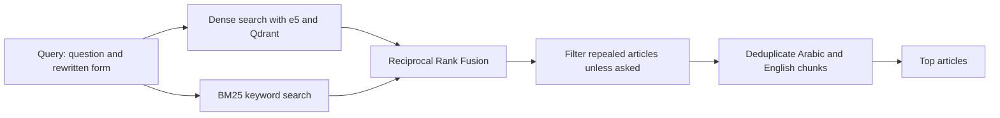
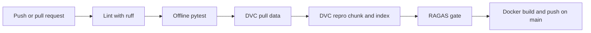

<div align="center">

# ⚖️ Arabic Legal Document Q&A

**Ask questions about the Egyptian Civil Code in Arabic (including colloquial Egyptian) or English, and get answers that cite the exact articles, or an honest refusal when the law text does not contain the answer.**

[](https://github.com/manarsaber2/Arabic-Legal-Document-QA/actions/workflows/ci.yml)


[Quick start](#-quick-start) · [Architecture](#-architecture) · [How it works](#-how-it-works) · [Results](#-results) · [API](#-api) · [MLOps](#-mlops-pipeline) · [Deviations](#-deviations-from-the-project-brief)

</div>

---

## 📌 What this project is

The source is a **scanned PDF of the Egyptian Civil Code with no text layer**. The project turns it into a searchable, bilingual knowledge base and puts a retrieval-augmented question answering (RAG) service on top of it:

1. **OCR and structuring**: a Gemini vision model reads the scanned pages column by column; the output is validated and stored as 1,149 article records (Arabic + English). Repealed articles are kept as flagged records instead of being dropped.
2. **Hybrid retrieval**: dense multilingual embeddings (Qdrant) and keyword search (BM25), fused with Reciprocal Rank Fusion.
3. **Grounded answers**: Gemini answers **only** from the retrieved articles, cites them, and refuses when they do not contain the answer.
4. **Production habits**: DVC data versioning, MLflow experiment tracking and model registry, Langfuse tracing, RAGAS evaluation with a CI quality gate, Docker, and an offline test suite.

## ✨ Highlights

| | |
|---|---|
| 🌍 **Bilingual, dialect aware** | Arabic and English questions. A query-rewriting step maps colloquial Egyptian Arabic to formal legal Arabic before searching, because the corpus is formal Arabic. |
| 🔎 **Hybrid retrieval** | e5 dense vectors on Qdrant + BM25, fused with RRF. Repealed articles are filtered unless the question is about repeal. |
| 📎 **Cited, grounded answers** | The response carries `sources` and the article texts (`passages`) behind them. When the law text has no answer, the sources are empty and the answer is an explicit refusal. |
| 🛡️ **Reliable by design** | Retry with backoff, fallback model, clean 503 when the LLM is unavailable, input validation (422), a single image that ships with its index. |
| 📈 **Measured, not assumed** | Retrieval sweep (6 configs) in MLflow, RAGAS evaluation on a 60-question synthetic set, per-question diagnostics to separate retrieval misses from refusals and judge noise. |
| 🔁 **Reproducible** | `dvc repro` rebuilds chunks and index from the data; a clean clone reproduces the same retrieval metrics. |

---

## 🏗 Architecture

### Overall system

The system has three parts: an **offline** pipeline that builds the knowledge base, an **online** service that answers questions, and a **quality** loop that measures and gates it.

**1. Offline: build the knowledge base** (DVC + MLflow)



**2. Online: answer a question** (FastAPI)



**3. Quality: measure and gate** (RAGAS)



### One request, step by step



### Hybrid retrieval



---

## 🚀 Quick start

Requires **Python 3.10**. No GPU needed.

```bash
git clone https://github.com/manarsaber2/Arabic-Legal-Document-QA.git
cd Arabic-Legal-Document-QA

# 1) Data: no account needed (md5 must be c2b02516c2b51ecd686c329717cfaa20)
mkdir -p data
curl -L -o data/articles.jsonl \
  https://github.com/manarsaber2/Arabic-Legal-Document-QA/releases/download/data-v1/articles.jsonl
md5sum data/articles.jsonl

# 2) Install + offline tests (no API key needed)
pip install -e ".[dev]"
pytest -q

# 3) Build the index (a few minutes on CPU; downloads multilingual-e5-small on first run)
python -m legal_qa.index

# 4) Add your Gemini key (only /ask needs it), then run
cp .env.example .env            # edit .env: GEMINI_API_KEY=<your key>
uvicorn legal_qa.api:app --port 8000
```

Try it at **http://localhost:8000/docs**, or:

```bash
curl localhost:8000/health
# {"status": "healthy", "documents_indexed": 2295}

curl -X POST localhost:8000/ask -H "content-type: application/json" \
     -d '{"question": "When does the legal personality of a person begin?"}'
```

<details>
<summary><b>Docker</b></summary>

Build the index first (step 3), then:

```bash
docker compose up --build        # the image bakes in data/index/best and the embedding model
```

`.env` is optional for Docker: without it the API starts, and only `/ask` needs `GEMINI_API_KEY`.
`docker compose --profile server up` starts a separate Qdrant server (then set `QDRANT_URL`, and build the index against it).
</details>

<details>
<summary><b>Which commands need an API key?</b></summary>

| Needs `GEMINI_API_KEY` | Works without any key |
|---|---|
| `POST /ask`, `POST /ask/stream` | `GET /health`, `POST /search` |
| `gen_eval.py`, `ragas_eval.py` | `pytest` (offline: fake embeddings, stub LLM), index build, `reindex` |

Without a key, `/ask` returns a clear **503** that says `/search` and `/health` still work.
Langfuse (`LANGFUSE_*`), a Qdrant server (`QDRANT_URL`) and the alert webhook are optional. See `.env.example`.
</details>

---

## 🔧 How it works

### 1. From scanned PDF to data
Gemini vision OCR reads the pages column by column and an automated validation step checks the result. The output is `data/articles.jsonl` with 1,149 articles, each with Arabic and English text, citation, breadcrumb and an `is_repealed` flag. **Repealed article ranges are expanded into individually flagged records instead of being dropped**, so repealed text is never silently lost and can still be retrieved when a question is about repeal. Extraction is paid and non-deterministic, so it runs offline once and its output is tracked as data (DVC), not as a pipeline stage.

### 2. Chunking
One chunk per (article, language): 2,295 chunks from 1,149 articles. Articles are short, so splitting them would separate a rule from its exception; `chunk_size = 600` and `overlap = 80` only matter for the rare long article (none were split in this corpus).

### 3. Embeddings and index
Only the **normalized article body** is embedded with `intfloat/multilingual-e5-small` (using the `passage:` / `query:` prefixes). Breadcrumbs, chapter titles and citations are kept as metadata for BM25 and display: embedding shared headings would pull sibling articles together in vector space. Vectors go to **Qdrant** (cosine). By default Qdrant runs in embedded mode inside the index folder, so the Docker image carries its own vector store; set `QDRANT_URL` to use a server instead.

### 4. Retrieval
Dense and BM25 rankings are fused with **Reciprocal Rank Fusion** (k = 60). Repealed articles are filtered unless the query mentions repeal, and the Arabic and English chunks of the same article are deduplicated.

### 5. Query rewriting
Most real questions are colloquial Egyptian Arabic, while the corpus is formal legal Arabic, and Arabic hit@5 without rewriting is only 0.33. One cheap Gemini call rewrites the question into formal legal wording; both forms are searched together. On any error it silently falls back to the original question, so `/ask` never breaks because of this step. Disable with `QUERY_REWRITE=0`.

### 6. Answer generation
Gemini receives the top `DEFAULT_K = 8` articles and must answer **only** from them, in the language of the question, citing article numbers. If the articles do not contain the answer it must reply with a fixed refusal sentence; the API then returns empty `sources` and `passages`, so a refusal never looks like a cited answer.

### 7. Reliability and observability
- Gemini 429/500/503 are retried with exponential backoff, then a fallback model is tried, then a clean 503 is returned.
- Input is validated: empty or blank questions return 422.
- Every request is traced in **Langfuse** (latency, retrieved articles, answerable flag); RAGAS faithfulness scores are attached to the same traces. Tracing is optional and does nothing without keys.
- If faithfulness drops below 0.80, an alert is posted to `ALERT_WEBHOOK_URL` (Slack-compatible).

### 8. Adding a new document
```bash
python -m legal_qa.reindex --add new_articles.jsonl
```
Merges the new articles, rebuilds the index into a temporary folder and swaps it in, so a failed rebuild never leaves a half-written index (covered by `tests/test_reindex.py`).

---

## 📊 Results

| What | Result |
|---|---|
| **Retrieval** (best config: `multilingual-e5-small`, chunk 600 / overlap 80; 60 questions, no query rewriting) | hit@5 **0.40**, MRR **0.28** (Arabic 0.33, English 0.50). All 6 configs are in `reports/mlflow_runs.csv` |
| **RAGAS** (first 30 of 60 questions, with query rewriting, judge `gemini-3.5-flash-lite`) | faithfulness **0.94** · context recall **0.80** |

**How to read these numbers**
- The overall faithfulness (0.76) is pulled down by refusals: an honest "the articles do not contain the answer" scores low on faithfulness even though nothing was invented. On the questions it did answer, faithfulness is 0.94. For this reason the CI gate is defined on answered questions (see Deviations); both numbers are reported.
- The eval questions are **synthetic** (LLM-written, reviewed by hand). Most Arabic ones are colloquial while the articles are formal Arabic with some OCR errors, and each question has a single gold article even though other articles may also be valid, which lowers context precision and recall. With about eight articles retrieved per question, precision cannot approach 1.
- The RAGAS run covers 20 questions, so one question moves a score by about 3 points.
- Retrieval metrics were measured without query rewriting; the 80% "gold article retrieved" figure includes it and uses top 8 instead of top 5, so the two are not directly comparable.

---

## 🔌 API

| Method | Path | Description |
|---|---|---|
| `GET` | `/health` | `{"status": "healthy", "documents_indexed": N}` |
| `POST` | `/ask` | `{"question": "..."}` → `{"answer", "sources": [str], "passages": [{article, citation, text}]}` |
| `POST` | `/ask/stream` | Server-Sent Events: `sources`, then `token` events, then `done` |
| `POST` | `/search` | Retrieval only (debugging and evaluation) |

Errors: **422** for an empty or blank question, **503** when the LLM is not configured or temporarily unavailable, **502** for a non-retryable LLM error.

---

## 🔁 MLOps pipeline



| Step | Command | Notes |
|---|---|---|
| Extraction (PDF → `articles.jsonl`) | `extraction.py`, `merge.py`, `clean_and_reprocess.py` | Gemini OCR: paid and non-deterministic, so it is **not** a DVC stage; its output is tracked as data |
| Chunk → index | `dvc repro` | stages `chunk`, `index`; parameters in `params.yaml` |
| Retrieval sweep | `python -m legal_qa.index --sweep` | 6 configs → 6 MLflow runs; the best is registered as `arabic-legal-qa-retriever@champion` |
| Eval set | `python -m legal_qa.gen_eval --n 60` | synthetic AR/EN questions with reference answers, **reviewed by hand** |
| RAGAS | `python -m legal_qa.ragas_eval` | faithfulness, answer relevancy, context precision/recall → MLflow; `--limit N` for a subset |
| Add a document | `python -m legal_qa.reindex --add new.jsonl` | rebuild + atomic swap |

**CI** (`.github/workflows/ci.yml`): lint → tests → `dvc pull` + `dvc repro` → RAGAS gate (30 questions; fails if faithfulness on answered questions is below 0.75) → build and push the image to GHCR (main only). Secrets: `GEMINI_API_KEY`, `DAGSHUB_USER`, `DAGSHUB_TOKEN`, optional `ALERT_WEBHOOK_URL`. The workflow can also be started by hand from the Actions tab.

**Tests** (`pytest -q`) run fully offline (hashed fake embeddings, stub LLM, embedded Qdrant in a temp dir): API contract including 422 on empty questions, refusal handling, repeal filtering, SSE streaming, query rewriting with fallback, chunking and normalization, re-indexing a new document, and corpus sanity checks (skipped if `data/articles.jsonl` is absent).

---

## 🗂 Project structure

```text
.
├── src/legal_qa/
│   ├── api.py            FastAPI service: /ask, /ask/stream, /search, /health
│   ├── retriever.py      embedder, Qdrant client, BM25, RRF fusion
│   ├── indexing.py       build_index(): chunks.jsonl + meta.json + Qdrant collection
│   ├── index.py          6-config sweep, MLflow runs, model registry, metrics report
│   ├── chunk.py          normalization + one chunk per (article, language)
│   ├── reindex.py        add new documents, rebuild and swap atomically
│   ├── gen_eval.py       synthetic eval-set generation
│   ├── ragas_eval.py     RAGAS evaluation, diagnostics, CI gate, alerting
│   └── tracing.py        optional Langfuse tracing and scores
├── tests/                offline test suite
├── data/                 articles.jsonl (DVC / release), eval/eval.jsonl (git)
├── reports/              MLflow runs table, retrieval metrics, RAGAS diagnostics
├── dvc.yaml, params.yaml chunk and index stages
├── Dockerfile, docker-compose.yml
└── .github/workflows/ci.yml
```

---

## 🔀 Deviations from the project brief

- **Gemini API instead of self-hosted vLLM**: therefore no BentoML serving and no AWQ quantization step. FastAPI serves the model-agnostic RAG logic.
- **Langfuse Cloud** instead of self-hosted (set `LANGFUSE_*` in `.env`; `LANGFUSE_HOST` switches to a self-hosted instance with no code change).
- **MLflow Registry holds the winning retrieval config** (embedding model, chunking, Qdrant collection) as a pyfunc model, not a trained model, since nothing is trained.
- **DVC covers chunk → index, not OCR** (see MLOps pipeline).
- **Data access without an account**: the DVC remote is on DagsHub, which asks for credentials even for reads, so the same `articles.jsonl` is also published as a GitHub release (`data-v1`) with its md5 for anyone running the project. CI uses the DagsHub remote with secrets.
- **Qdrant**: embedded local store shipped inside the Docker image by default; set `QDRANT_URL` for a Qdrant server. Embedded mode allows one API process, so scale with replicas.
- **Query rewriting** (`QUERY_REWRITE=1`, default): one extra Gemini call per question, described above. Retrieval metrics in Results were measured without it; RAGAS numbers include it.
- **CI gate definition**: the gate uses faithfulness over the questions the system answered, not over all questions. A refusal is the intended behaviour when retrieval misses, but it scores low on faithfulness, so the plain mean mixes hallucination with refusal rate. Both are reported (overall 0.76, answered 0.94).
- `/ask` passes the top `DEFAULT_K = 8` articles to the LLM (`k` is adjustable per request, max 10).
